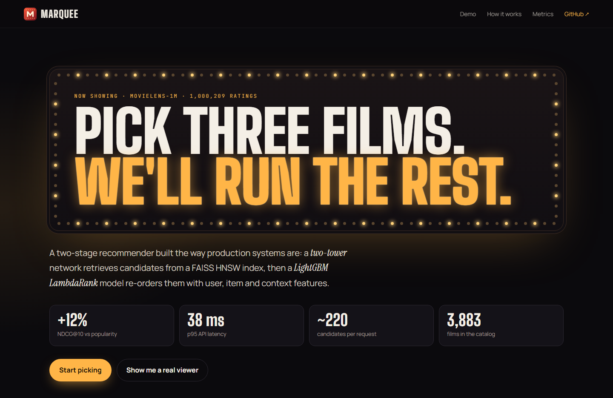
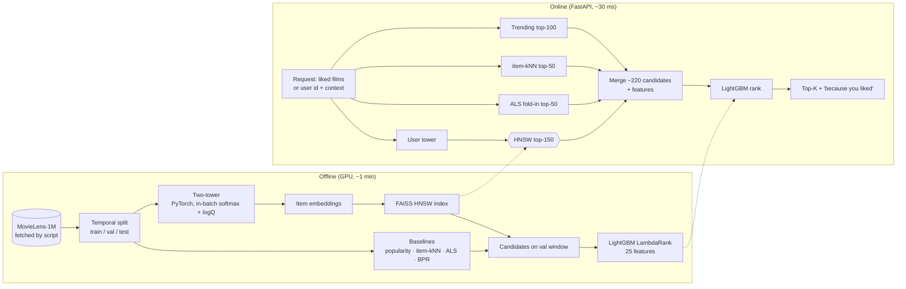
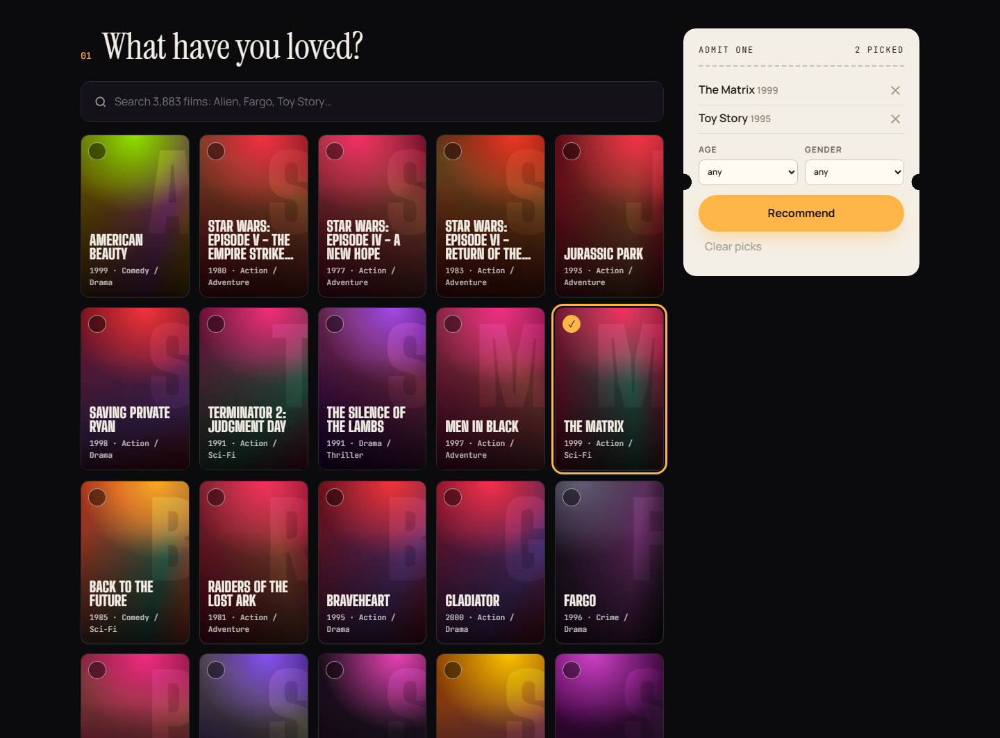
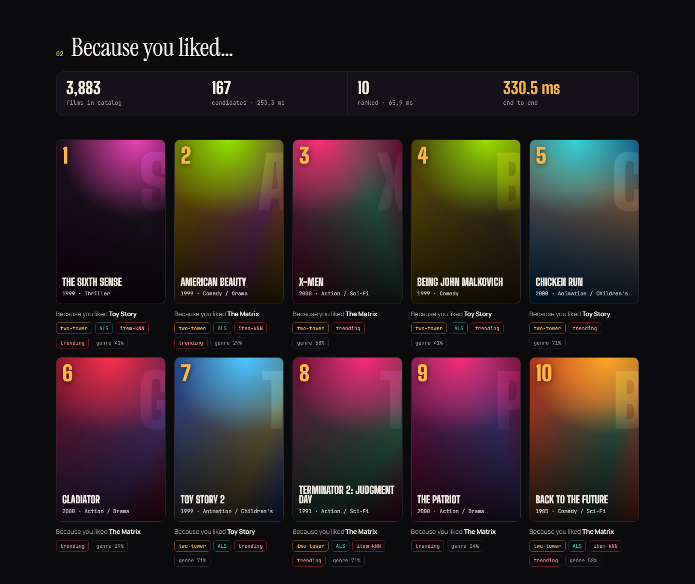
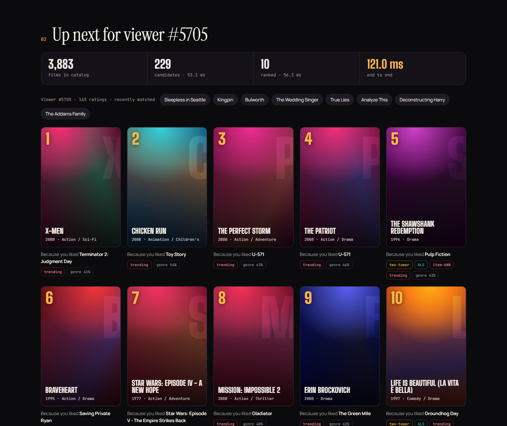
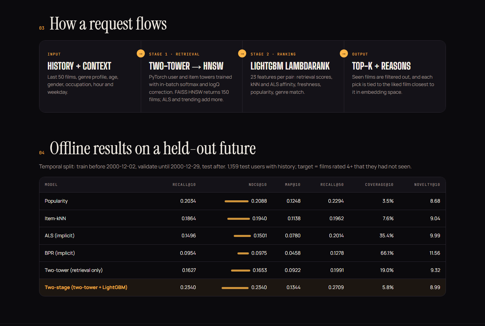

<p align="center"></p>

<h1 align="center">Marquee</h1>

<p align="center"><b>A two-stage movie recommender, built the way production systems are.</b><br>
Two-tower retrieval over a FAISS HNSW index, then a LightGBM LambdaRank re-ranker, served by FastAPI at ~30 ms p50.</p>

<p align="center">
<a href="https://github.com/alok-kul5/marquee-recs/actions/workflows/ci.yml"></a>


</p>



## Results

On a **leak-free temporal split** of MovieLens-1M (train before 2000-12-02, validate until 2000-12-29, test after),
the target is every film a user rated 4 or 5 in the test window and had not seen before. There are 1,159 test users with history.

| Model | Recall@10 | NDCG@10 | MAP@10 | Recall@50 | Coverage@10 | Novelty@10 |
|---|---:|---:|---:|---:|---:|---:|
| Popularity (all-time + last 30 days) | 0.2034 | 0.2088 | 0.1248 | 0.2294 | 3.5% | 8.68 |
| Item-kNN (cosine, 100 neighbours) | 0.1864 | 0.1940 | 0.1138 | 0.1962 | 7.6% | 9.04 |
| ALS (`implicit`) | 0.1496 | 0.1501 | 0.0780 | 0.2014 | 35.4% | 9.99 |
| BPR (`implicit`) | 0.0954 | 0.0975 | 0.0458 | 0.1278 | 66.1% | 11.56 |
| Two-tower, retrieval only | 0.1627 | 0.1653 | 0.0922 | 0.1991 | 19.0% | 9.32 |
| **Two-stage: two-tower + LightGBM** | **0.2340** | **0.2340** | **0.1344** | **0.2709** | 5.8% | 8.99 |

- The two-stage system beats the best baseline by **+12% NDCG@10, +15% Recall@10 and +18% Recall@50**.
- **Popularity is hard to beat on this split.** Most ML-1M ratings after late 2000 come from users catching up on the
  big releases, so a trend-aware popularity list beats every personalised single model. Any honest MovieLens result
  should say so. The ranker wins because it learns *when* to trust trend features (recent counts, film age, days on
  site) and when to trust personal signals (kNN, ALS, two-tower).
- Candidate recall (share of test positives among the ~220 candidates) is 0.39, which caps what any ranker can reach.
- API latency over 500 mixed requests: **p50 29 ms, p95 38 ms, p99 52 ms** end to end on a laptop CPU. The model alone
  takes p50 20 ms and p95 30 ms (`scripts/bench_latency.py`).
- Top ranker features by gain: film age, Bayesian mean rating, 30-day popularity, item-kNN score, ALS score, popularity rank.

### Cold start

| Case | How it is handled | Result |
|---|---|---|
| **New user, zero history** (29 test users) | The user tower has no user-id embedding. It runs on demographics plus an empty history, and the ranker adds trend features. | Popularity NDCG@10 0.467, two-tower 0.421, two-stage 0.420. With so few users, the honest answer is to serve popularity until there are a few interactions. |
| **New user with a few picks** (the demo) | History pooling plus ALS fold-in (a least-squares user vector from item factors) gives a personalised result from a single liked film. | See the screenshots. |
| **New item** (205 films with no plays before the test window) | The item tower trains with 15% item-id dropout, so it can embed any film from its genres and release year alone. | Only 44 test positives were cold items, and none reached the top 50: a known gap. A content-heavy tower or an exploration slot is the next step. |

## Architecture



**Training protocol, so the test is never seen:**
1. *Stage A.* Fit every candidate model on train. Build ranker examples from two labelled windows: the validation
   window, plus an earlier window carved out of train with its own refit. Train LambdaRank, early-stopped on held-out validation users.
2. *Stage B.* Refit the candidate models on train + val with the same settings and score test with the stage-A ranker.
   Every system is evaluated on the same users, with already-seen films filtered out.

**Two-tower model** ([`marquee/two_tower.py`](marquee/two_tower.py)):
- The user tower pools the last 50 films (mean pooling plus recency-weighted pooling) and adds a genre profile,
  age, gender, occupation and history length. It has no user-id embedding, so new users work.
- The item tower combines an id embedding (with dropout), a genre multi-hot vector and a release-year bucket.
- Training uses in-batch sampled softmax at temperature 0.05, with duplicate-item masking and a logQ term.
  The logQ weight was tuned on the validation window: 2.0 beat 1.0 and 0.5, because a popularity prior pays off on this data.
- Each sample's history holds only interactions *before* that sample. Histories are randomly truncated during
  training so the model also learns short histories.
- 6 epochs over 800k interactions take ~20 s on an RTX 5050 laptop GPU (Blackwell, PyTorch cu128 wheel).

**Ranker features** ([`marquee/pipeline.py`](marquee/pipeline.py)), 25 in all:
- *retrieval:* two-tower score and rank, ALS score, item-kNN score, source flags
- *item:* log popularity, 30-day popularity, popularity rank, Bayesian mean rating, rating count, film age, days on site
- *user:* activity, mean rating, days since last visit, demographics
- *user × item:* genre affinity, release-year gap
- *context:* hour and weekday of the request

## Demo

The demo is a single page served by the same FastAPI app. Pick films, or press *Show me a real viewer*. Every result
shows which retrieval sources found it, its genre match, and the liked film closest to it in embedding space.






<sub>Latency in the screenshots comes from a headless capture on a busy machine. The p50/p95 figures above are from the benchmark script.</sub>

## Run it

```bash
py -3.11 -m venv .venv && .venv\Scripts\activate          # Windows; use source .venv/bin/activate elsewhere
pip install torch --index-url https://download.pytorch.org/whl/cu128   # or /whl/cpu
pip install -r requirements.txt

python -m marquee.run                 # downloads ML-1M into data/, trains, evaluates, writes artifacts/
python scripts/bench_latency.py       # p50 / p95 / p99 -> artifacts/latency.json
uvicorn serve.app:app --port 8077     # open http://localhost:8077
```

API:

| Endpoint | What it does |
|---|---|
| `POST /api/recommend` `{"liked": [ids], "k": 10, "age": 2, "gender": 1}` | Ad-hoc user (cold start when `liked` is empty) |
| `GET /api/users/{id}?k=10` | A real MovieLens user's history and recommendations |
| `GET /api/movies?q=alien` · `GET /api/popular` | Catalog search and trending list |
| `GET /api/stats` | Live p50/p95, benchmark results and offline metrics |

## Tests and CI

`pytest` runs the metric maths, split leakage checks and a full pipeline run, then calls every API endpoint. The
pipeline test uses a **tiny synthetic dataset** in MovieLens format, generated on the fly. GitHub Actions runs it on
CPU in a few minutes. No MovieLens data is ever committed: the GroupLens licence forbids redistribution, so
`marquee.data.fetch_ml1m()` downloads it at build time.

## Layout

```
marquee/      data.py (fetch, temporal split) · metrics.py · baselines.py · two_tower.py · pipeline.py · run.py
serve/        app.py (FastAPI + static demo)
web/          index.html · styles.css · app.js
scripts/      bench_latency.py · tune_tower.py · screenshots.py
tests/        metrics, split, end-to-end pipeline + API
```

---

<sub>Data: F. Maxwell Harper and Joseph A. Konstan, "The MovieLens Datasets: History and Context", ACM TiiS 2015. MovieLens-1M © GroupLens Research, used under its terms and not redistributed here.</sub>

<sub>One of twelve projects by [Alok Kulkarni](https://alok.is-a.dev): [Hearth](https://github.com/alok-kul5/hearth-iot) home sensors · [Headway](https://github.com/alok-kul5/headway-transit) transit data · [Vigil](https://github.com/alok-kul5/vigil-soc) security triage · [Loupe](https://github.com/alok-kul5/loupe-vision) defect inspection · [Kharcha](https://github.com/alok-kul5/kharcha-finance) personal finance · [Stockroom](https://github.com/alok-kul5/stockroom-inventory) inventory · [Quietwire](https://github.com/alok-kul5/quietwire-villa) smart home design · [Canopy](https://alok.is-a.dev/canopy/) coffee storefront · [Picket](https://github.com/alok-kul5/picket) detection rules · [Warden](https://github.com/alok-kul5/warden-iac) cloud IaC scanning · **Marquee** recommendations · [Kestrel](https://github.com/alok-kul5/kestrel) fraud detection.</sub>
